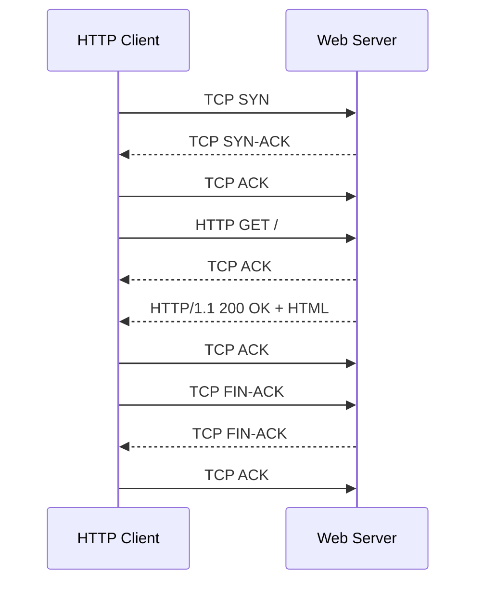

# Network Traffic Analysis: HTTP over TCP

A lab-based packet-analysis case study using Linux networking tools to observe an HTTP request and response, inspect packet headers, and identify the TCP connection lifecycle.

## Project goals

- Access a lab server over SSH and inspect listening TCP ports.
- Request a web page from the command line using `wget` and `curl`.
- Capture HTTP traffic with `tcpdump` and interpret packet flags.
- Identify the TCP three-way handshake, HTTP request/response exchange, acknowledgements, and connection teardown.
- Inspect an Ethernet II / IPv4 / TCP packet using the hexadecimal dump.

## Tools and concepts

| Tool or concept | How it was used |
|---|---|
| SSH | Access the lab server |
| `ss -tlnp` | Inspect listening TCP sockets |
| `wget` and `curl -v` | Request the HTTP resource and view response details |
| `tcpdump` | Capture packets matching TCP port 80 and a selected host |
| Ethernet II | Inspect source/destination MAC fields and EtherType |
| IPv4 | Read packet length, TTL, protocol, and endpoint fields |
| TCP | Interpret ports, sequence/acknowledgement numbers, flags, and window |
| HTTP | Identify the GET request and the `200 OK` response |

## Key findings

- The capture contained **10 packets** for a short HTTP transaction.
- The beginning of the capture showed the TCP handshake: **SYN → SYN-ACK → ACK**.
- The client then sent an HTTP `GET /` request to TCP port 80.
- The server responded with **HTTP/1.1 200 OK** and the HTML body `<html><body><h1>It works!</h1></body></html>`.
- The observed exchange ended with TCP FIN/ACK teardown packets.
- The first packet was an Ethernet II frame carrying an IPv4 packet with TCP (protocol number 6).

See the [packet-by-packet analysis](docs/packet-analysis.md), [commands and method](docs/commands-and-method.md), [flow diagram](diagrams/http-tcp-flow.mmd), and [sanitized evidence excerpts](evidence/redacted-capture-excerpts.md).

## Visual Packet Analysis

## Packet flow

## Privacy and scope

The example excerpts in this repository are sanitized for public sharing: internal endpoint addresses and MAC addresses are replaced by descriptive labels. The original raw capture is not needed to understand the analysis and is not reproduced here. The analysis describes a controlled university lab exercise, not a scan of public systems.

## Reproducibility

The command examples in the documentation illustrate the lab procedure. Run packet capture only on systems and networks where you have authorization. The analysis is based on the uploaded lab output; the capture was not rerun as part of preparing this repository.

## Skills demonstrated

Linux networking, TCP/IP fundamentals, HTTP, packet capture, hex-dump interpretation, socket/port inspection, and technical documentation.
